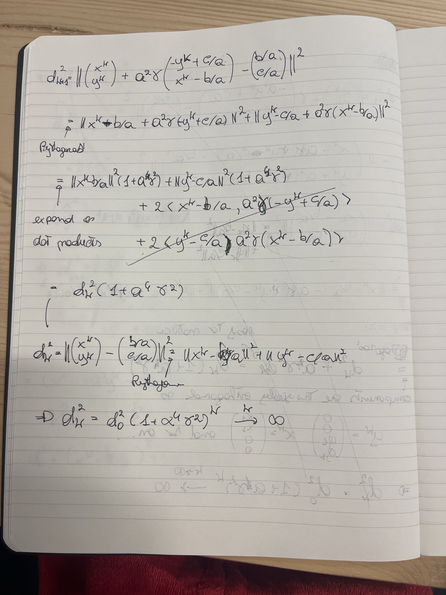
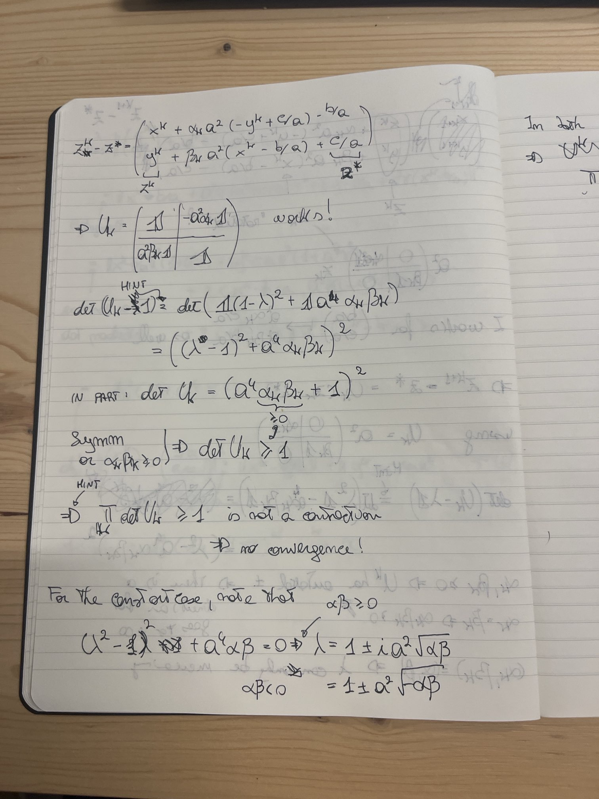
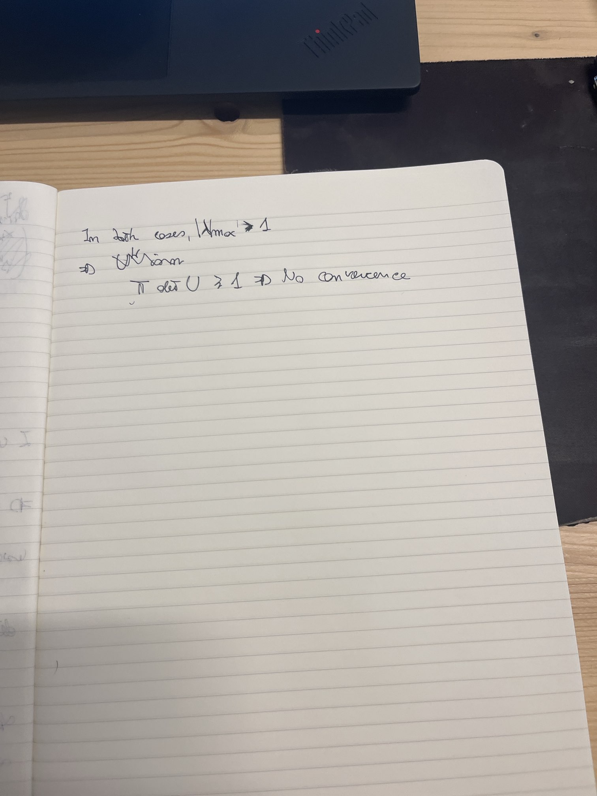
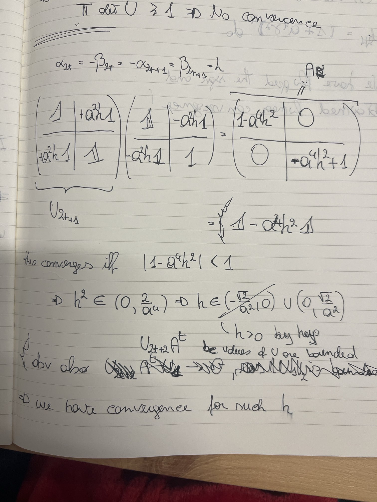
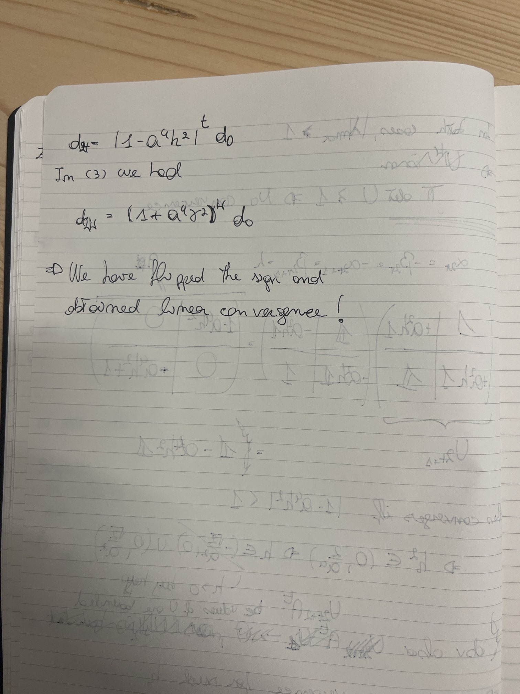
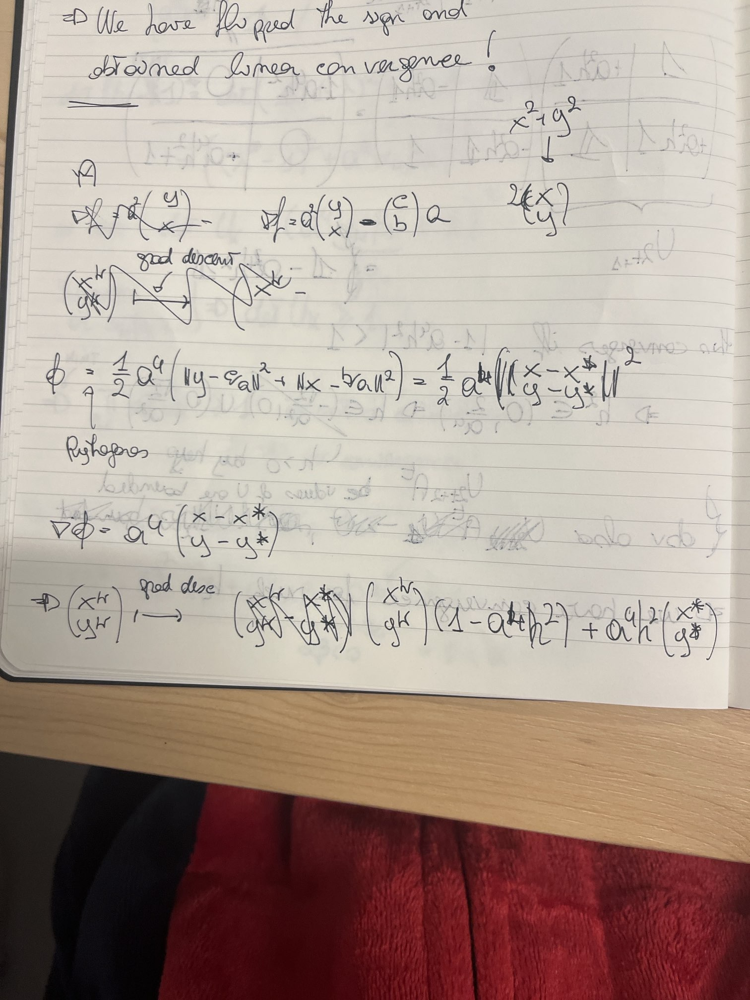
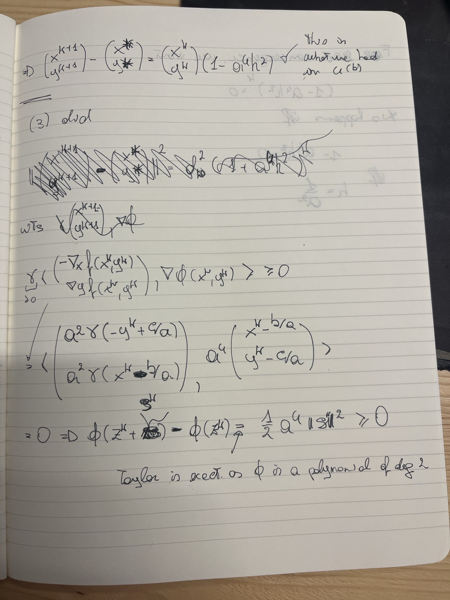
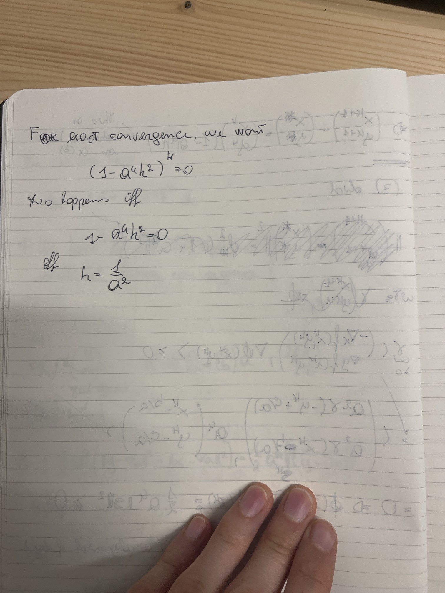
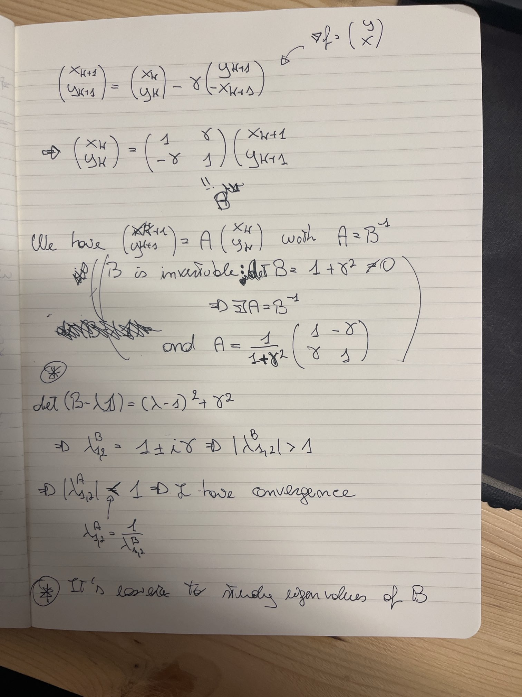

# HW2 (EE-556 Mathematics of Data, Fall 2026) — AI conversation log

- **Tool:** Claude (Cowork mode, desktop app), model Claude Opus 5.5
- **Date:** 22 November 2026
- **Group member using AI:** Antonio
- **Scope:** theory parts of Section 1 — 1.1 (3), (4.a), (4.b), (4.c) and 1.2 (4). Questions 1.1 (1) and (2) were done before this conversation.

**How the AI was used.** The chat could not be shared through a public link, so this file is a complete transcript. Antonio wrote every solution by hand. He sent photos of his notes, and Claude (i) checked the mathematics and (ii) turned the handwritten argument into a clean markdown/LaTeX cell, following Antonio's strategy. Claude was told to follow a style guide built from HW1 and to stop and report any error instead of fixing it silently. The photos of the handwritten notes are in the folder `hw2_chat_images/`, next to this file.

Claude's replies below are copied verbatim. Antonio's messages are translated from Italian, with the original in parentheses.

---

## 1. User

> Read Homework 2, Section 1 carefully. In this chat I will send you my proofs on paper to translate into markdown.
> *(Leggi per bene l'homework2 sezione 1. Io in questa chat ti mando le proof su carta da tradurre in markdown)*

## 1. Claude

*(Claude read the HW2 notebook from the user's folder and, following the agreed rule, gave no hints or solutions.)*

Letto.

---

## 2. User — Question 1.1 (3)

> I already did q1 and q2. This is q3.
> *(Ho già fatto q1 e q2. Questa è q3)*



## 2. Claude

Controllo: la matematica è corretta. Ho fatto solo due ritocchi minori, già inclusi nella trascrizione. Nell'ultima riga hai scritto $\alpha^4$ invece di $a^4$. Poi ho reso esplicito il tasso, $d_k = d_0(1+a^4\gamma^2)^{k/2}$, insieme alle ipotesi che servono per la divergenza ($d_0>0$, $a \neq 0$, $\gamma>0$).

*(Translation: Check: the mathematics is correct. Two minor touch-ups, already included in the transcription: in the last line you wrote $\alpha^4$ instead of $a^4$, and I made the rate $d_k = d_0(1+a^4\gamma^2)^{k/2}$ explicit, together with the hypotheses needed for divergence.)*

```markdown
Using $\nabla_x f = a(ay - c)$, $\nabla_y f = a(ax - b)$ and $(x^\star, y^\star) = (b/a, c/a)$ from (2), we get
$$
\begin{align*}
d_{k+1}^2 &= \left\| \begin{pmatrix} x^k \\ y^k \end{pmatrix} + a^2\gamma \begin{pmatrix} -y^k + c/a \\ x^k - b/a \end{pmatrix} - \begin{pmatrix} b/a \\ c/a \end{pmatrix} \right\|_2^2 \\
&\overset{\text{Pythagoras}}{=} \left\|x^k - b/a + a^2\gamma(-y^k + c/a)\right\|_2^2 + \left\|y^k - c/a + a^2\gamma(x^k - b/a)\right\|_2^2 \\
&\overset{(i)}{=} \left\|x^k - b/a\right\|_2^2 (1 + a^4\gamma^2) + \left\|y^k - c/a\right\|_2^2 (1 + a^4\gamma^2) \\
&\qquad + 2\left\langle x^k - b/a,\, a^2\gamma(-y^k + c/a) \right\rangle + 2\left\langle y^k - c/a,\, a^2\gamma(x^k - b/a) \right\rangle \\
&\overset{(ii)}{=} d_k^2 (1 + a^4\gamma^2)
\end{align*}
$$
where (i) expands the squared norms as inner products, and in (ii) the two cross terms cancel, being opposite to each other, while
$$
d_k^2 = \left\| \begin{pmatrix} x^k \\ y^k \end{pmatrix} - \begin{pmatrix} b/a \\ c/a \end{pmatrix} \right\|_2^2 \overset{\text{Pythagoras}}{=} \left\|x^k - b/a\right\|_2^2 + \left\|y^k - c/a\right\|_2^2 .
$$
Therefore
$$
d_k^2 = d_0^2 \left(1 + a^4\gamma^2\right)^k \xrightarrow{k \to \infty} \infty
$$
since $d_0 > 0$ for $(x^0, y^0) \neq (x^\star, y^\star)$ and $a^4\gamma^2 > 0$ for $a \neq 0$, $\gamma > 0$. The distance grows exponentially, $d_k = d_0 \left(1 + a^4\gamma^2\right)^{k/2}$, by a factor $\sqrt{1 + a^4\gamma^2}$ per iteration.
```

---

## 3. User — Question 1.1 (4.a)

> This is q4 (a).
> *(Questa è la q4 (a))*




## 3. Claude

Controllo: tutto torna tranne l'ultima riga del caso costante. Prima di trascrivere ho bisogno che tu decida come chiuderlo.

**Il problema.** Nel caso costante concludi con "$\prod \det U \geq 1 \implies$ no convergence". Questo non vale quando $\alpha\beta < 0$. Lì $\det U = (1 + a^4\alpha\beta)^2$ può essere minore di $1$: con $a^4\alpha\beta = -1/2$ viene $\det U = 1/4$. È proprio per questo che l'hint dice di usare gli autovalori in questo caso.

**Come sistemarlo (una frase).** Hai già dimostrato che $|\lambda_{\max}| \geq 1$ in entrambi i casi. Da lì basta dire:
$$\rho(U) \geq 1 \implies U^k \not\to 0.$$
Più concretamente: se $v$ è un autovettore di $\lambda_{\max}$, partendo da $z^0 = z^\star + v$ si ha $\|z^k - z^\star\| = |\lambda_{\max}|^k \|v\| \geq \|v\|$, quindi non si converge. Forse la riga cancellata nella seconda foto ("$\Rightarrow U^k \ldots$") era proprio questa. Se è così, tengo quella e tolgo la riga col determinante.

**Due note minori**, che correggo direttamente nella trascrizione:

1. Nella seconda riga di $z^{k+1} - z^\star$ in fondo ci va $-c/a$, non $+c/a$. Va sottratto $z^\star$; sembra un refuso.
2. Cosa dimostra davvero l'argomento. $\|P_k\|_2 \geq 1$, con $P_k = U_{k-1} \cdots U_0$, dice che $P_k \not\to 0$, cioè che **non si converge da ogni punto iniziale**. Alcuni punti particolari possono invece convergere. Esempio: con $\alpha\beta<0$ costante, $\lambda_- = 1 - a^2\sqrt{-\alpha\beta}$ può avere modulo $<1$, e partendo lungo quell'autovettore si converge. Nella prova scriverei "fail to converge from every starting point", che è il senso dell'hint.

Va bene la correzione con $\rho(U) \geq 1 \implies U^k \not\to 0$? Se sì, trascrivo.

*(Translation: Everything checks out except the last line of the constant case. The conclusion "$\prod \det U \geq 1 \implies$ no convergence" fails when $\alpha\beta<0$, because $\det U = (1+a^4\alpha\beta)^2$ can be smaller than $1$. Suggested fix: from $|\lambda_{\max}| \geq 1$ conclude $\rho(U) \geq 1 \implies U^k \not\to 0$. Minor notes: a sign typo ($-c/a$), and the argument proves non-convergence from every starting point, not from each single one. Claude asked whether to proceed with this fix.)*

---

## 4. User

> Yes, that's right. The correct thing to say was that the eigenspaces are always the same, so the eigenvalue is preserved under multiplication and always stays above 1.
> *(si, è vero, la cosa corretta da dire era che gli autospazi sono sempre gli stessi quindi l'autovalore si conserva per moltiplicazione e rimane sempre sopra 1)*

## 4. Claude

Controllo: con la tua correzione la prova è completa. Ho incluso anche le due note minori: $-c/a$ e "from every starting point".

```markdown
Since $\nabla_x f = a^2(y - c/a)$ and $\nabla_y f = a^2(x - b/a)$, we have
$$
\begin{align*}
z^{k+1} - z^\star &= \begin{pmatrix} x^k + \alpha_k a^2(-y^k + c/a) - b/a \\ y^k + \beta_k a^2(x^k - b/a) - c/a \end{pmatrix} \\ \\
\implies U_k &= \begin{bmatrix} I & -a^2\alpha_k I \\ a^2\beta_k I & I \end{bmatrix}, \qquad I \in \mathbb{R}^{2 \times 2}.
\end{align*}
$$
Its characteristic polynomial is
$$
\begin{align*}
\det\left(U_k - \lambda I_4\right) &\overset{\text{hint}}{=} \det\left((1-\lambda)^2 I + a^4\alpha_k\beta_k I\right) \\
&= \left((\lambda - 1)^2 + a^4\alpha_k\beta_k\right)^2
\end{align*}
$$
where the hint applies because all blocks are scalar multiples of $I$. In particular, for $\lambda = 0$,
$$
\det U_k = \left(a^4\alpha_k\beta_k + 1\right)^2 \geq 1
$$
whenever $\alpha_k\beta_k \geq 0$, which holds both for nonnegative schedules and for symmetric ones ($\alpha_k\beta_k = \alpha_k^2$). Then, since $z^k - z^\star = U_{k-1} \cdots U_0 (z^0 - z^\star)$,
$$
\left\|U_{k-1} \cdots U_0\right\|_2 \overset{\text{hint}}{\geq} \left|\det\left(U_{k-1} \cdots U_0\right)\right|^{1/4} = \prod_{j=0}^{k-1} \left|\det U_j\right|^{1/4} \geq 1
$$
so the product is never a contraction, it does not tend to $0$, and the iterates fail to converge from every starting point.

For the constant case $U_k \equiv U$, the eigenvalues solve $(\lambda - 1)^2 + a^4\alpha\beta = 0$:
$$
\begin{align*}
\alpha\beta \geq 0 &\implies \lambda = 1 \pm i a^2\sqrt{\alpha\beta}, \qquad |\lambda| = \sqrt{1 + a^4\alpha\beta} \geq 1 \\
\alpha\beta < 0 &\implies \lambda = 1 \pm a^2\sqrt{-\alpha\beta}, \qquad \lambda_+ > 1
\end{align*}
$$
In both cases $|\lambda_{\max}| \geq 1$. Since the matrix is the same at every step, so are its eigenvectors: for an eigenvector $v$ of $\lambda_{\max}$ we get $U^k v = \lambda_{\max}^k v$, hence $\|U^k v\|_2 = |\lambda_{\max}|^k \|v\|_2 \geq \|v\|_2$. Therefore $U^k \not\to 0$ and there is no convergence.
```

---

## 5. User — Question 1.1 (4.b)

> This is 4(b).
> *(Questa è la 4(b))*




## 5. Claude

Controllo: la matematica è corretta. Ho sistemato due dettagli minori. Per gli iterati dispari scrivi $U_{2t+2}A^t$, ma va $U_{2t}A^t$: tutte le matrici pari sono uguali, quindi conta solo che sia una matrice fissa. Nel confronto con (3) ho letto $d_{2t} = (1+a^4\gamma^2)^t d_0$, cioè su due passi. È coerente con (3), dove $d_k = (1+a^4\gamma^2)^{k/2} d_0$.

*(Translation: The mathematics is correct. Two minor details fixed: for the odd iterates it should be $U_{2t}A^t$ rather than $U_{2t+2}A^t$, and the comparison with (3) was read as a two-step factor, $d_{2t} = (1+a^4\gamma^2)^t d_0$.)*

```markdown
With $\alpha_{2t} = -\beta_{2t} = -\alpha_{2t+1} = \beta_{2t+1} = h$, the matrix $U_k$ of (4.a) gives
$$
\begin{align*}
A := U_{2t+1} U_{2t} &= \begin{bmatrix} I & a^2 h I \\ a^2 h I & I \end{bmatrix} \begin{bmatrix} I & -a^2 h I \\ -a^2 h I & I \end{bmatrix} \\
&= \begin{bmatrix} (1 - a^4 h^2) I & 0 \\ 0 & (1 - a^4 h^2) I \end{bmatrix} \\
&= (1 - a^4 h^2) I_4 .
\end{align*}
$$
Then $z^{2t} - z^\star = A^t (z^0 - z^\star) = (1 - a^4h^2)^t (z^0 - z^\star)$, which converges iff
$$
\begin{align*}
\left|1 - a^4 h^2\right| < 1
&\implies h^2 \in \left(0, \frac{2}{a^4}\right) \\
&\implies h \in \left(0, \frac{\sqrt{2}}{a^2}\right)
\end{align*}
$$
where in the last step we used $h > 0$ by hypothesis. The odd iterates also converge, since $z^{2t+1} - z^\star = U_{2t} A^t (z^0 - z^\star)$ and $U_{2t}$ is the same matrix for every $t$, so $\|z^{2t+1} - z^\star\|_2 \leq \|U_{2t}\|_2 \left|1 - a^4h^2\right|^t d_0 \to 0$. Therefore we have convergence for such $h$, with
$$
d_{2t} = \left|1 - a^4h^2\right|^t d_0 .
$$
In (3) we had
$$
d_{2t} = \left(1 + a^4\gamma^2\right)^t d_0 ,
$$
so we have flipped the sign in the two-step factor and obtained linear convergence.
```

---

## 6. User — Question 1.1 (4.c)

> This is the solution of 4(c).
> *(Questa è la soluzione del 4(c))*





## 6. Claude

Controllo: la matematica è corretta. Ho sistemato due dettagli minori. Nella riga del passo di gradient descent manca $-z^\star$ a destra: deve essere $(1-a^4h^2)(z - z^\star)$. Poi la domanda chiede anche dopo quanti passi si arriva esattamente a $z^\star$, quindi l'ho scritto: due passi, cioè una coppia slingshot.

*(Translation: The mathematics is correct. Two minor details fixed: a missing $-z^\star$ on the right-hand side of the gradient-descent step, and the number of steps to reach $z^\star$ exactly (two, i.e. one slingshot pair) is now stated explicitly, as the question asks.)*

```markdown
Since $\nabla f = a^2 \begin{pmatrix} y \\ x \end{pmatrix} - a \begin{pmatrix} c \\ b \end{pmatrix}$, we get
$$
\begin{align*}
\Phi(x,y) &\overset{\text{Pythagoras}}{=} \frac{1}{2} a^4 \left( \|y - c/a\|_2^2 + \|x - b/a\|_2^2 \right) = \frac{1}{2} a^4 \left\| \begin{pmatrix} x - x^\star \\ y - y^\star \end{pmatrix} \right\|_2^2 \\ \\
\implies \nabla \Phi(x,y) &= a^4 \begin{pmatrix} x - x^\star \\ y - y^\star \end{pmatrix} .
\end{align*}
$$
A gradient descent step on $\Phi$ with stepsize $h^2$ from $z^{2t}$ gives
$$
\begin{align*}
z^{2t} - h^2 \nabla\Phi(z^{2t}) &= (1 - a^4h^2)\, z^{2t} + a^4h^2\, z^\star \\ \\
\implies z^{2t} - h^2 \nabla\Phi(z^{2t}) - z^\star &= (1 - a^4h^2)(z^{2t} - z^\star)
\end{align*}
$$
which is exactly $z^{2t+2} - z^\star = A(z^{2t} - z^\star)$ from (4.b).

For a single update of (3), let $s^k := z^{k+1} - z^k$. Then
$$
\begin{align*}
\left\langle s^k, \nabla\Phi(z^k) \right\rangle
&= \gamma \left\langle \begin{pmatrix} -\nabla_x f(x^k, y^k) \\ \nabla_y f(x^k, y^k) \end{pmatrix}, \nabla\Phi(x^k, y^k) \right\rangle \\
&= \left\langle \begin{pmatrix} a^2\gamma(-y^k + c/a) \\ a^2\gamma(x^k - b/a) \end{pmatrix}, a^4 \begin{pmatrix} x^k - b/a \\ y^k - c/a \end{pmatrix} \right\rangle \\
&= 0
\end{align*}
$$
since the two terms are opposite to each other. Therefore
$$
\Phi(z^k + s^k) - \Phi(z^k) \overset{\text{Taylor}}{=} \left\langle \nabla\Phi(z^k), s^k \right\rangle + \frac{1}{2} a^4 \|s^k\|_2^2 = \frac{1}{2} a^4 \|s^k\|_2^2 \geq 0
$$
where Taylor's expansion is exact because $\Phi$ is a polynomial of degree $2$, with $\nabla^2\Phi = a^4 I_4$.

For exact convergence, we want
$$
(1 - a^4h^2)^t = 0
$$
which happens iff $1 - a^4h^2 = 0$, iff $h = 1/a^2$. In this case $z^2 = z^\star$, so the iterates reach the saddle point after two steps, i.e. one slingshot pair.
```

---

## 7. User — Question 1.2 (4), PPM

> This is q4 of Section 1.2, the only theory part left.
> *(Questa è la q4 della sezione 1.2, è l'unica parte teorica rimasta)*



## 7. Claude

Controllo: nessun problema. Ho aggiunto soltanto, in mezza frase, che il limite è il punto di sella $(0,0)$ e che serve $\gamma > 0$ per avere $|\lambda^B| > 1$ stretto.

*(Translation: No problems. I only added, in half a sentence, that the limit is the saddle point $(0,0)$ and that $\gamma > 0$ is needed for the strict inequality $|\lambda^B| > 1$.)*

```markdown
Since $\nabla f = \begin{pmatrix} y \\ x \end{pmatrix}$, the PPM update reads
$$
\begin{align*}
\begin{pmatrix} x_{k+1} \\ y_{k+1} \end{pmatrix} &= \begin{pmatrix} x_k \\ y_k \end{pmatrix} - \gamma \begin{pmatrix} y_{k+1} \\ -x_{k+1} \end{pmatrix} \\ \\
\implies \begin{pmatrix} x_k \\ y_k \end{pmatrix} &= \underbrace{\begin{pmatrix} 1 & \gamma \\ -\gamma & 1 \end{pmatrix}}_{=: B} \begin{pmatrix} x_{k+1} \\ y_{k+1} \end{pmatrix} .
\end{align*}
$$
$B$ is invertible, since $\det B = 1 + \gamma^2 \neq 0$, so we have $z_{k+1} = A z_k$ with
$$
A = B^{-1} = \frac{1}{1 + \gamma^2} \begin{pmatrix} 1 & -\gamma \\ \gamma & 1 \end{pmatrix} .
$$
It's easier to study the eigenvalues of $B$:
$$
\begin{align*}
\det(B - \lambda I) &= (\lambda - 1)^2 + \gamma^2 \\ \\
\implies \lambda^B_{1,2} &= 1 \pm i\gamma \implies \left|\lambda^B_{1,2}\right| = \sqrt{1 + \gamma^2} > 1 \\ \\
\implies \left|\lambda^A_{1,2}\right| &\overset{(i)}{=} \frac{1}{\left|\lambda^B_{1,2}\right|} < 1
\end{align*}
$$
where (i) holds because $A = B^{-1}$, so $\lambda^A_{1,2} = 1/\lambda^B_{1,2}$. Therefore $\rho(A) < 1$, hence $A^k \to 0$ and $z_k = A^k z_0 \to 0$, i.e. PPM converges to the saddle point $(x^\star, y^\star) = (0, 0)$ for every $\gamma > 0$.
```

---

## 8. User

> Produce a .md file of our conversation. I will attach it for the TAs, since this chat cannot be shared.
> *(Produci un file.md della nostra conversazione. La allegherò per i TA, dato che questa chat non si può condividere)*

## 8. Claude

*(This file.)*
